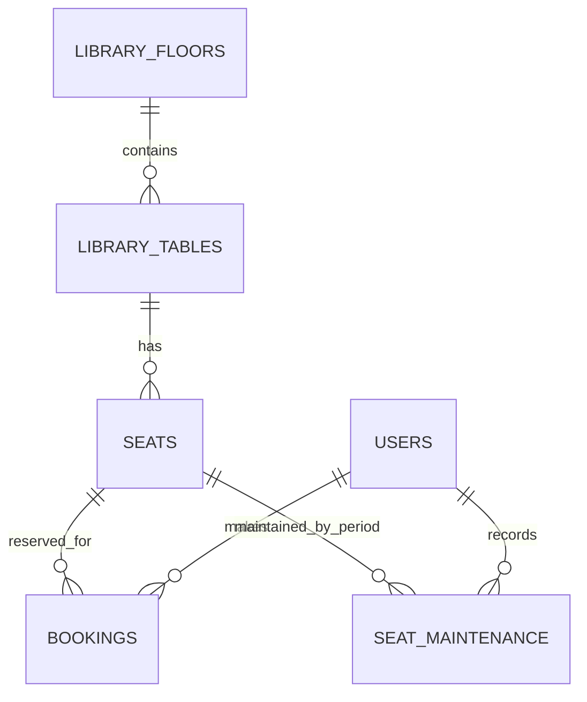

# SeatSpace PostgreSQL audit (migration-source review)

**Scope and evidence:** checked-in migration review plus a live, read-only PostgreSQL catalog/data snapshot taken on 24 November 2026. Live queries ran inside `BEGIN READ ONLY` and were rolled back; no database data or schema was changed.

## Live database snapshot

- PostgreSQL 18.6, database `seatspace`.
- Connected role: `postgres`, which is a superuser. The backend currently uses this same configured connection. This violates least privilege and should be corrected with a separate restricted application login after a migration/operations plan is prepared.
- Public tables and row counts at snapshot time: `users` 4, `library_floors` 1, `library_tables` 24, `seats` 154, `bookings` 15, `seat_maintenance` 0, `legacy_user_access_archive` 4.
- Booking statuses at snapshot time: 7 cancelled, 6 completed, 2 no-show. No confirmed bookings were present in that snapshot. These are historical counts, not current occupancy metrics.
- The inert legacy archive contains one `admin/approved`, one `student/approved`, and two `student/pending` records. The former admin value is historical only; it has not been reactivated as an active role.
- No public views or materialized views, user-defined public triggers, user-defined public functions, or migration-named ledger tables were found. Row-level security is disabled on every public table.
- Live catalog relationships/constraints agree with the migration-defined model. The live schema includes the check-in columns introduced by migration `002`.

The counts can change as bookings are created or expire. This snapshot must not be presented as live dashboard analytics.

## Entity relationships

`library_floors` stores a floor number, label, and layout document. `library_tables` belongs to a floor and stores its display label, seat count, position, dimensions, and indoor/outdoor flag. `seats` belongs to a table and stores a stable ID, table-relative number, and position. `bookings` connects a user and seat for a time interval. `seat_maintenance` records a seat block and the user who entered it. The current application is restricted to the approved third-floor layout; this description does not add other floors.

## Constraints and transaction safety present in migrations

- UUID primary keys are used for users, bookings, and maintenance blocks; floor number and textual table/seat IDs are primary keys for their respective entities.
- Foreign keys connect tables to floors, seats to tables, bookings to seats/users, and maintenance to seats/users.
- User email is unique; seat number is unique within a table.
- Names, seat counts/numbers, maintenance reasons, booking status, and positive time ranges have checks or `NOT NULL` constraints.
- `btree_gist` exclusion constraints reject overlapping `[start_at, end_at)` ranges for confirmed bookings on one seat and for maintenance blocks on one seat.
- Migrations add lookup indexes for a user's bookings, seat/time searches, maintenance searches, seats by table, check-in expiry, and active booking ends.
- `server/db.js` wraps work with `BEGIN`/`COMMIT`/`ROLLBACK`. The booking route additionally obtains a per-seat transaction advisory lock and checks booking/maintenance overlap. PostgreSQL exclusion conflicts are translated to HTTP 409.

## Normalization review from the source definitions

The core booking relation stores each booking's seat, user, interval, and status once, with user and seat details referenced by keys. Seat and table entities are separated, avoiding repeating student or table metadata on each booking. This is broadly consistent with 3NF for the operational records. Position, dimensions, and the floor layout are JSONB documents by design; their internal structure is not constrained relationally by these migrations and should be validated by the application/layout contract. `seat_count` is also stored on `library_tables` while individual `seats` exist; it is a potential derived-value consistency risk unless seeding/update code ensures they agree.

## Not present in the checked-in migrations

The inspected migrations do not define PostgreSQL views/materialized views, stored functions, triggers, row-level security policies, or a database role hierarchy. The users schema shown here has no role column after migration `003`; migration `003` preserves retired role/eligibility values in `legacy_user_access_archive` before dropping those live columns. Any administrator authorization must therefore be verified in the backend/application configuration rather than inferred from this schema.

MongoDB event logging, if configured, is a separate optional event store. It is not the source of truth for seats or reservations.

## Next safe database stage

1. Add a real applied-migration ledger before broadening the default migration runner. Until then, the reviewed analysis migration can be applied alone via `npm run db:migrate:analysis`.
2. Create a separate restricted application database role and audit its actual grants before deployment. The current configured login is a superuser.
3. Implement and test remaining concurrency demonstrations only with isolated test records/database, never by resetting or deleting student history.

## Incremental analysis objects added

Migration `005_database_analysis_views.sql` was applied alone on 24 November 2026. It adds two ordinary current-state views and one daily analytics materialized view. The current-state views report seat/table status based on confirmed bookings, check-ins, and maintenance blocks at query time; they are informational and do not replace the booking transaction's overlap check. `seat_usage_daily` is limited to third-floor reservation history and must be refreshed to include newer records. Its unique date/table index allows concurrent refreshes. No existing booking rows are changed by this migration. A read-only follow-up confirmed both ordinary views and the populated materialized view are present; the current-state view returned 154 available seats in that snapshot, and the daily summary contained 10 table/date rows.

The Database Lab UI and routes are restricted to email addresses explicitly listed in the backend-only `ADMIN_EMAILS` environment variable. It is currently left empty; per the owner’s instruction, all existing accounts remain students and no archived admin is restored. `EXPLAIN ANALYZE` runs only fixed, read-only SELECT statements and returns PostgreSQL's actual plan and timing. MongoDB's `activity_events` remains the audit-event source; the page labels it separately from the PostgreSQL transactional records. No database credentials or arbitrary SQL are exposed to the browser. The endpoint’s anonymous access was verified to return HTTP 401; authenticated access cannot be exercised until an administrator is explicitly designated.

Not yet implemented: PostgreSQL-native audit triggers/table, database role/RLS policy, isolated concurrency harness, views for each requested reporting category, and a full before/after index experiment. The existing database account configured by this checkout is a superuser; setting an admin email does not solve that least-privilege deployment issue.

One real read-only availability `EXPLAIN (ANALYZE, BUFFERS, FORMAT JSON)` was run on 24 November 2026 inside `BEGIN READ ONLY`. On this small snapshot PostgreSQL planned in 35.601 ms and executed in 2.025 ms; the plan used sequential scans of `seats` and `bookings` (the booking scan examined 15 rows and found no current confirmed match) and a primary-key index scan on `library_tables`. This is one measurement on a tiny dataset, not a before/after benchmark and not evidence that new indexes are needed.
